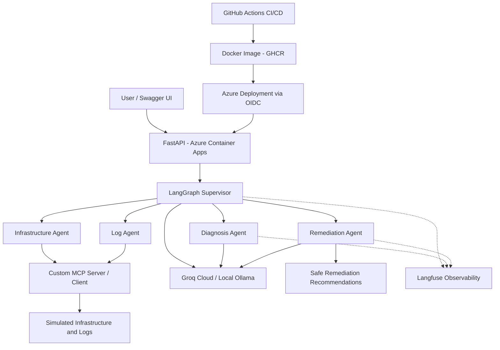

# DevOps Pilot AI
### Multi-Agent DevOps Incident Investigation Platform

DevOps Pilot AI is a cloud-deployed, multi-agent AI application that investigates simulated infrastructure incidents using LangGraph orchestration, custom Model Context Protocol (MCP) tools, and large language models.

The platform checks service health, retrieves application logs, analyzes possible causes, and generates safe remediation recommendations.

## Key Features

- **Multi-Agent Orchestration:** LangGraph coordinates five specialized agents: Supervisor, Infrastructure, Log, Diagnosis, and Remediation.
- **Custom MCP Integration:** A custom MCP server and client provide simulated infrastructure health information and application logs.
- **AI-Powered Diagnosis:** LLMs analyze incident evidence and identify potential root causes.
- **Safe Remediation:** The system recommends troubleshooting actions and identifies changes requiring human approval. It does not automatically execute remediation commands.
- **LLM Observability:** Langfuse captures agent execution traces and LLM interactions.
- **CI/CD:** GitHub Actions runs automated tests, builds Docker images, publishes them to GitHub Container Registry, and includes an Azure deployment stage.
- **Cloud Deployment:** FastAPI runs in Azure Container Apps.

## System Architecture




```text
User / Swagger UI
       |
       v
FastAPI REST API (Azure Container Apps)
       |
       v
LangGraph Supervisor
       |
       +--> Infrastructure Agent --> Custom MCP Tools
       |
       +--> Log Agent ------------> Custom MCP Tools
       |
       +--> Diagnosis Agent ------> Groq LLM
       |
       +--> Remediation Agent ----> Groq LLM
       |
       v
Investigation Results
       |
       v
Langfuse Observability
```

Langfuse traces the LangGraph workflow and supported LLM operations.

## Technology Stack

| Category | Technologies |
|---|---|
| Programming | Python |
| Agent orchestration | LangGraph, LangChain |
| LLM | Ollama (local), Groq (cloud) |
| Tool integration | Custom MCP server/client |
| API | FastAPI, Uvicorn |
| Containerization | Docker |
| CI/CD | GitHub Actions |
| Container registry | GitHub Container Registry |
| Cloud | Azure Container Apps |
| Observability | Langfuse |
| Testing | pytest |

## Example Investigation

**Service:** `worker`

**Request:** Investigate why the worker service is unhealthy, check its logs, and recommend safe remediation steps.

The simulated environment reports an unhealthy worker service and application logs containing database connection timeouts and job-processing errors.

The agents retrieve evidence, analyze potential causes, and recommend safe troubleshooting steps without automatically modifying infrastructure.

## API Endpoints

- `GET /` — Application information
- `GET /health` — Application health check
- `POST /investigate` — Run a multi-agent incident investigation

### Example Request

```json
{
  "service_name": "worker",
  "user_request": "Investigate why the worker service is unhealthy, check its logs, and recommend safe remediation steps."
}
```

## Live Azure Deployment

[Open DevOps Pilot AI Swagger UI](https://devops-pilot-ai.orangemeadow-31d43b26.germanywestcentral.azurecontainerapps.io/docs)

The application is deployed using Docker and Azure Container Apps.

## CI/CD Pipeline

```text
GitHub Push
     |
     v
Run pytest Tests
     |
     v
Build Docker Image
     |
     v
Publish Image to GHCR
     |
     v
Deploy to Azure Container Apps
```

### Secure CI/CD Deployment

The project uses GitHub Actions to automate testing, Docker image building, publishing to GitHub Container Registry (GHCR), and deployment to Azure Container Apps.

**GitHub OpenID Connect (OIDC)** is used for secure authentication between GitHub Actions and Microsoft Azure, avoiding long-lived Azure credentials in GitHub.

The deployment pipeline follows this sequence:

1. Run automated Python tests using pytest.
2. Build the application Docker image.
3. Publish versioned Docker images to GHCR.
4. Authenticate with Azure using GitHub OIDC.
5. Update the Azure Container App with the new image.

Application secrets, including Groq and Langfuse credentials, are managed using Azure Container Apps Secrets rather than hardcoded into the source code.
## Observability

Langfuse provides visibility into LangGraph execution, individual agent steps, and supported LLM calls.

A cloud investigation has successfully produced a trace containing the Supervisor workflow, infrastructure checks, log analysis, diagnosis, and remediation steps.

## Security and Safety

- Cloud LLM credentials and Langfuse API keys are configured through Azure Container Apps Secrets.
- Remediation is recommendation-only.
- Service and infrastructure changes require human approval.
- Diagnostic conclusions distinguish suspected causes from confirmed evidence.

## Project Status

The core multi-agent application, MCP integration, Docker packaging, Azure deployment, and Langfuse tracing have been implemented and tested.

## Author

Jyothi Rajan

[GitHub](https://github.com/Jyothi162) | [Portfolio](https://jyothi-ai-portfolio.vercel.app)
